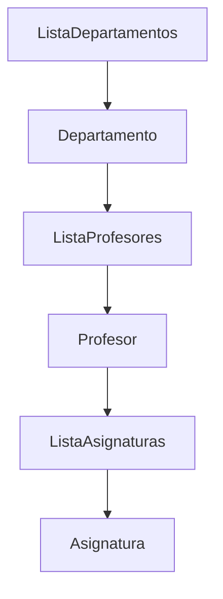
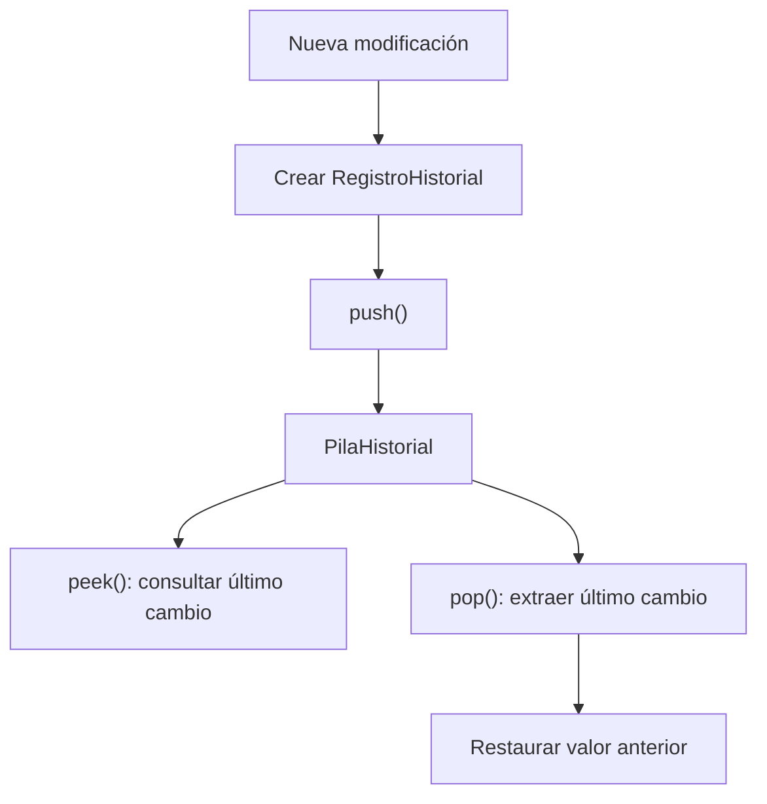
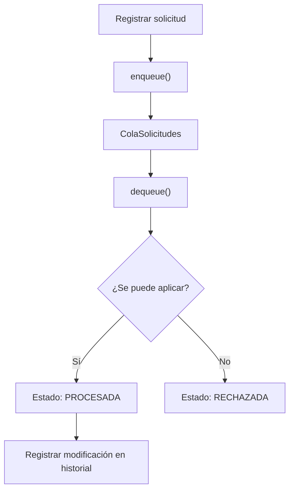
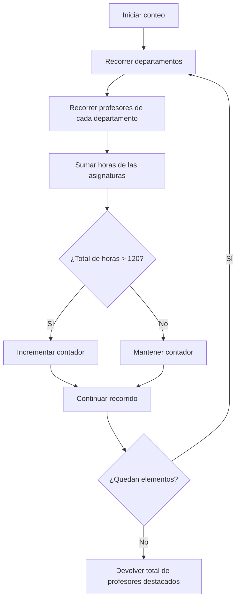

# Gestión Académica y Carga Docente

Proyecto del Equipo 1 para la asignatura **Estructuras de Datos**. Consiste en un sistema desarrollado en Java para administrar la carga docente de diferentes departamentos, gestionar la información de profesores y asignaturas, registrar modificaciones y procesar solicitudes de actualización.

---

## Índice

- [1. Descripcion general](#1-descripcion-general)
- [2. Objetivos del proyecto](#2-objetivos-del-proyecto)
- [3. Funcionalidades principales](#3-funcionalidades-principales)
- [4. Arquitectura y modelo de datos](#4-arquitectura-y-modelo-de-datos)
- [5. Estructuras de datos](#5-estructuras-de-datos)
- [6. Recorrido recursivo y profesores destacados](#6-recorrido-recursivo-y-profesores-destacados)
- [7. Validaciones y manejo de excepciones](#7-validaciones-y-manejo-de-excepciones)
- [8. Pruebas manuales](#8-pruebas-manuales)
- [9. Estructura del repositorio](#9-estructura-del-repositorio)
- [10. Requisitos y ejecucion](#10-requisitos-y-ejecucion)
- [11. Documentacion](#11-documentacion)
- [12. Integrantes del equipo](#12-integrantes-del-equipo)
- [13. Uso de inteligencia artificial](#13-uso-de-inteligencia-artificial)

---

## 1. Descripcion general

La gestión de la carga docente requiere organizar la información de los departamentos, los profesores que pertenecen a ellos y las asignaturas que imparte cada profesor.

Este proyecto implementa una solución que permite mantener esa información relacionada y realizar operaciones sobre sus elementos. Además, incorpora dos estructuras auxiliares para gestionar el historial de modificaciones y las solicitudes de actualización.

El sistema está desarrollado en **Java**, utilizando estructuras enlazadas implementadas por el equipo. Las estructuras centrales no dependen de las clases `ArrayList`, `LinkedList`, `Stack` ni `Queue` de Java.

## 2. Objetivos del proyecto

El objetivo principal es aplicar los conocimientos de estructuras de datos mediante la implementación de un sistema de gestión académica.

Los objetivos específicos son:

- Organizar departamentos, profesores y asignaturas mediante una estructura jerárquica.
- Implementar operaciones de inserción, búsqueda, listado, actualización y eliminación.
- Mantener un historial de modificaciones mediante una pila LIFO.
- Gestionar solicitudes de actualización mediante una cola FIFO.
- Utilizar recorridos recursivos para calcular la cantidad de profesores destacados.
- Validar los datos y controlar los errores mediante excepciones personalizadas.

## 3. Funcionalidades principales

El sistema permite realizar las siguientes operaciones:

### Gestión de departamentos

- Crear departamentos.
- Buscar departamentos por nombre.
- Listar los departamentos registrados.
- Eliminar departamentos.
- Consultar la cantidad de departamentos.

### Gestión de profesores

Cada profesor almacena los siguientes datos:

- Nombre.
- Categoría docente.
- Grado científico.
- Edad.
- Evaluación.

El sistema permite:

- Agregar profesores a un departamento.
- Buscar profesores.
- Listar profesores.
- Eliminar profesores.
- Actualizar sus datos.
- Consultar la cantidad de profesores.
- Calcular sus horas docentes a partir de las asignaturas asociadas.

### Gestión de asignaturas

Cada asignatura contiene:

- Nombre.
- Cantidad de horas.

El sistema permite:

- Agregar asignaturas a un profesor.
- Buscar asignaturas.
- Listar asignaturas.
- Actualizar las horas de una asignatura.
- Eliminar asignaturas.
- Calcular el total de horas docentes de un profesor.

### Historial de modificaciones

El sistema registra modificaciones sobre los datos de los profesores y las horas de sus asignaturas. También permite consultar el historial y deshacer la última modificación registrada.

### Solicitudes de actualización

Permite registrar solicitudes para modificar datos de profesores o las horas de sus asignaturas. Las solicitudes se procesan en el orden en que fueron incorporadas a la cola.

## 4. Arquitectura y modelo de datos

La información principal del sistema se organiza mediante una estructura jerárquica de tres niveles:

**Departamento → Profesor → Asignatura**

Cada departamento contiene una lista de profesores y cada profesor contiene una lista de asignaturas.

### Diagrama de la estructura principal



### Organización de los elementos

- Los departamentos se agregan en el orden de creación.
- Los profesores se insertan en orden alfabético.
- Las asignaturas se insertan en orden alfabético.
- Los nombres identifican de forma única los elementos dentro de su nivel correspondiente.

### Componentes principales

| Componente | Responsabilidad |
|---|---|
| `SistemaGestionAcademica` | Coordina las operaciones generales del sistema. |
| `ListaDepartamentos` | Administra la lista de departamentos. |
| `ListaProfesores` | Administra los profesores de cada departamento. |
| `ListaAsignaturas` | Administra las asignaturas de cada profesor. |
| `PilaHistorial` | Mantiene el historial de modificaciones. |
| `ColaSolicitudes` | Gestiona las solicitudes de actualización. |
| `Profesor` | Representa los datos de un profesor y sus asignaturas. |
| `Departamento` | Representa un departamento y sus profesores. |
| `Asignatura` | Representa una asignatura y su cantidad de horas. |

## 5. Estructuras de datos

El proyecto utiliza tres estructuras principales: una multilista para organizar la información académica, una pila para almacenar el historial y una cola para procesar solicitudes.

### 5.1. Multilista de departamentos, profesores y asignaturas

La estructura principal está formada por listas enlazadas relacionadas jerárquicamente:

```text
ListaDepartamentos
└── Departamento
    └── ListaProfesores
        └── Profesor
            └── ListaAsignaturas
                └── Asignatura
```

Esta organización permite acceder a los datos siguiendo la relación entre departamentos, profesores y asignaturas.

Cada nivel administra sus propios elementos y ofrece operaciones para insertar, buscar, listar y eliminar.

### 5.2. Pila de historial (LIFO)

La clase `PilaHistorial` implementa una pila basada en el principio **LIFO (Last In, First Out)**.

Esto significa que el último cambio registrado es el primero que se consulta o se extrae de la estructura.

Cada registro del historial conserva información como:

- Turno del cambio.
- Descripción de la modificación.
- Departamento afectado.
- Profesor afectado.
- Asignatura, cuando corresponde.
- Tipo de modificación.
- Valor anterior.
- Valor nuevo.

Se registran modificaciones relacionadas con:

- Categoría docente.
- Grado científico.
- Edad.
- Evaluación.
- Horas de una asignatura.

La operación de deshacer utiliza el último registro para restaurar el valor anterior.



### 5.3. Cola de solicitudes (FIFO)

La clase `ColaSolicitudes` implementa una cola basada en el principio **FIFO (First In, First Out)**.

Esto significa que la primera solicitud registrada es la primera que se procesa.

Las solicitudes pueden encontrarse en los siguientes estados:

| Estado | Descripción |
|---|---|
| `PENDIENTE` | La solicitud está registrada y espera a ser procesada. |
| `PROCESADA` | La solicitud se aplicó correctamente. |
| `RECHAZADA` | La solicitud no pudo aplicarse. |

Cuando una solicitud se procesa correctamente, el cambio correspondiente también queda registrado en el historial.



## 6. Recorrido recursivo y profesores destacados

El sistema utiliza recursividad para recorrer la estructura jerárquica y determinar cuántos profesores cumplen la condición de profesor destacado.

Un profesor se considera **destacado cuando la suma de las horas de todas sus asignaturas es estrictamente mayor que 120**.

Por tanto:

| Total de horas | ¿Es destacado? |
|---:|---|
| 100 | No |
| 120 | No |
| 121 | Sí |
| 130 | Sí |

El recorrido recursivo se realiza en los siguientes niveles:

1. La lista de departamentos recorre sus departamentos.
2. Cada departamento recorre su lista de profesores.
3. Cada profesor recorre sus asignaturas para calcular el total de horas.
4. Se determina si el profesor cumple la condición de destacado.



La comparación es estrictamente `> 120`, por lo que un profesor con exactamente 120 horas no se considera destacado.

## 7. Validaciones y manejo de excepciones

El sistema incorpora validaciones para evitar datos incorrectos y controlar situaciones en las que una operación no puede realizarse.

Se utilizan excepciones personalizadas para representar diferentes tipos de errores.

| Excepción | Situación en la que se utiliza |
|---|---|
| `DatoInvalidoException` | Cuando se proporciona un dato nulo, vacío o que no cumple las condiciones establecidas. |
| `ElementoDuplicadoException` | Cuando se intenta insertar un elemento que ya existe en su nivel correspondiente. |
| `ElementoNoEncontradoException` | Cuando se intenta buscar, actualizar o eliminar un elemento inexistente. |
| `EstructuraVaciaException` | Cuando se intenta consultar o extraer un elemento de una estructura vacía. |

### Validaciones principales

- Los nombres no pueden estar vacíos.
- No se admiten elementos nulos en las operaciones de inserción.
- No se permiten nombres duplicados dentro del mismo nivel.
- Las asignaturas deben tener una cantidad de horas positiva.
- La edad no puede ser negativa.
- La evaluación debe encontrarse entre 0 y 100.
- Las solicitudes deben contener los datos necesarios según el tipo de modificación.
- No se puede procesar una cola vacía.
- No se puede extraer ni consultar el elemento superior de una pila vacía.

Estas validaciones permiten mantener la coherencia de la información y controlar los errores durante la ejecución.

## 8. Pruebas manuales

El archivo `Main.java` contiene pruebas manuales para comprobar el comportamiento de las estructuras y las operaciones del sistema.

Las pruebas están organizadas en los siguientes grupos:

| Grupo de pruebas | Casos contemplados |
|---|---|
| Asignaturas | Inserción válida, duplicados, horas inválidas, búsqueda, actualización y eliminación. |
| Profesores | Creación, validación de datos, duplicados, búsqueda, actualización, eliminación y orden alfabético. |
| Departamentos | Creación, búsqueda, duplicados, eliminación y asociación de profesores. |
| Pila de historial | Inserción de registros, consulta, extracción, pila vacía y orden LIFO. |
| Cola de solicitudes | Inserción, consulta, extracción, cola vacía, validación de solicitudes y orden FIFO. |
| Sistema integrado | Operaciones combinadas, actualización de datos, historial, deshacer modificaciones y procesamiento de solicitudes. |

### Casos importantes comprobados por el código de pruebas

- Intentar insertar elementos duplicados.
- Intentar insertar datos nulos o vacíos.
- Introducir horas negativas o iguales a cero en una asignatura.
- Introducir evaluaciones fuera del intervalo permitido.
- Buscar elementos que no existen.
- Eliminar elementos inexistentes.
- Consultar o extraer elementos de una pila vacía.
- Consultar o extraer elementos de una cola vacía.
- Verificar el orden LIFO de la pila.
- Verificar el procesamiento de solicitudes y sus estados.
- Verificar que una solicitud rechazada no genere una modificación en el historial.
- Actualizar las horas de una asignatura y deshacer el cambio.
- Verificar el conteo de profesores destacados antes y después de modificar sus horas.

### Resultado de las pruebas

Al ejecutar `Main.java`, el programa informa:

- Cantidad de pruebas exitosas.
- Cantidad de pruebas fallidas.


## 9. Estructura del repositorio

El proyecto está organizado de la siguiente manera:

```text
Parcial-2/
│
├── documentación/
│   └── Presentación.pptx
│   ├── Documentacion.pdf
│   ├── Cola_Explicada_Linea_por_Linea.html
│   ├── Pila_Explicada_Linea_por_Linea.html
│   ├── Multilista_Explicada_Linea_por_Linea.html
│   └── Recursividad_Explicada_Linea_por_Linea.html
│
├── src/
│   └── com/
│       └── equipo1/
│           └── gestionacademica/
│               ├── Main.java
│               ├── SistemaGestionAcademica.java
│               ├── estructuras/
│               ├── modelo/
│               └── excepciones/
│
└── README.md
```

### Descripción de los directorios

| Directorio o archivo | Contenido |
|---|---|
| `documentación/` | Material de documentación y presentación del proyecto. |
| `src/` | Código fuente de la aplicación. |
| `estructuras/` | Implementaciones de las estructuras de datos utilizadas. |
| `modelo/` | Clases que representan las entidades y registros del sistema. |
| `excepciones/` | Excepciones personalizadas para el control de errores. |
| `Main.java` | Punto de entrada y pruebas manuales del proyecto. |
| `README.md` | Documentación general del proyecto. |

## 10. Requisitos y ejecucion

### Requisitos

Para compilar y ejecutar el proyecto se necesita:

- Tener instalado el JDK de Java.
- Disponer de los comandos `javac` y `java` en el `PATH`.
- Clonar o descargar el repositorio.

### Obtener el proyecto

```bash
git clone https://github.com/RelaxUniver/Parcial-2.git
cd Parcial-2
```

### Compilar y ejecutar en Linux o macOS

Desde la raíz del proyecto:

```bash
mkdir -p out
javac -encoding UTF-8 -d out $(find src -name '*.java')
java -cp out com.equipo1.gestionacademica.Main
```

### Compilar y ejecutar en Windows PowerShell

Desde la raíz del proyecto:

```powershell
New-Item -ItemType Directory -Force out | Out-Null
$sources = Get-ChildItem -Recurse src -Filter *.java | ForEach-Object FullName
javac -encoding UTF-8 -d out $sources
java -cp out com.equipo1.gestionacademica.Main
```

Al ejecutar el programa se iniciarán las pruebas manuales y se mostrará el resumen de resultados en la consola.

## 11. Documentacion

Los materiales relacionados con el proyecto se encuentran en el directorio de documentación y en el código fuente del repositorio.

| Recurso | Enlace |
|---|---|
| Carpeta de documentación | [Abrir documentación](documentación/) |
| Presentación del proyecto | [Abrir presentación](documentación/Presentación.pptx) |
| Código fuente principal | [Explorar código fuente](src/com/equipo1/gestionacademica/) |
| Estructuras de datos | [Explorar estructuras](src/com/equipo1/gestionacademica/estructuras/) |
| Modelo de datos | [Explorar modelo](src/com/equipo1/gestionacademica/modelo/) |
| Excepciones | [Explorar excepciones](src/com/equipo1/gestionacademica/excepciones/) |
| Pruebas manuales | [Consultar Main.java](src/com/equipo1/gestionacademica/Main.java) |

## 12. Integrantes del equipo

| Integrante | Perfil de GitHub |
|---|---|
| Yaisel Pinos Durán | [@RelaxUniver](https://github.com/RelaxUniver) |
| Merlyn Sosa Borges | [@m3rlynn](https://github.com/m3rlynn) |
| Geonel Sánchez | [@GeoDev-2006](https://github.com/GeoDev-2006) |
| Jorge Luis Reyes Pérez | [@jorgeluisreyes331-cloud](https://github.com/jorgeluisreyes331-cloud) |
| Ray Sanjudo Mesa | [@raysanjudo2006-netizen](https://github.com/raysanjudo2006-netizen) |

## 13. Uso de inteligencia artificial

La inteligencia artificial se utilizó como herramienta de apoyo para agilizar tareas relacionadas con la escritura de código, la elaboración de pruebas y la documentación del proyecto.

No se utilizó para sustituir el razonamiento del equipo ni para tomar las decisiones principales sobre el diseño y la solución del problema.

El análisis, el diseño de las estructuras, la comprensión del funcionamiento y las decisiones fundamentales del proyecto fueron responsabilidad de los integrantes del equipo.